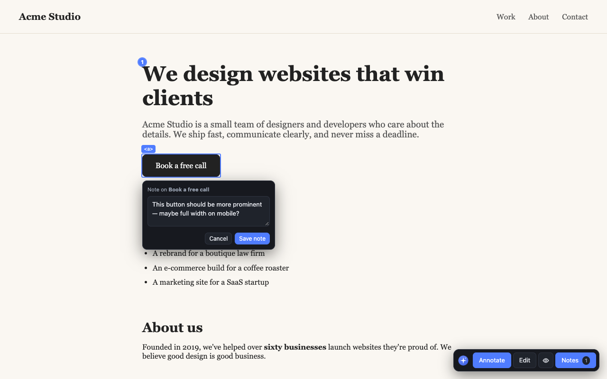
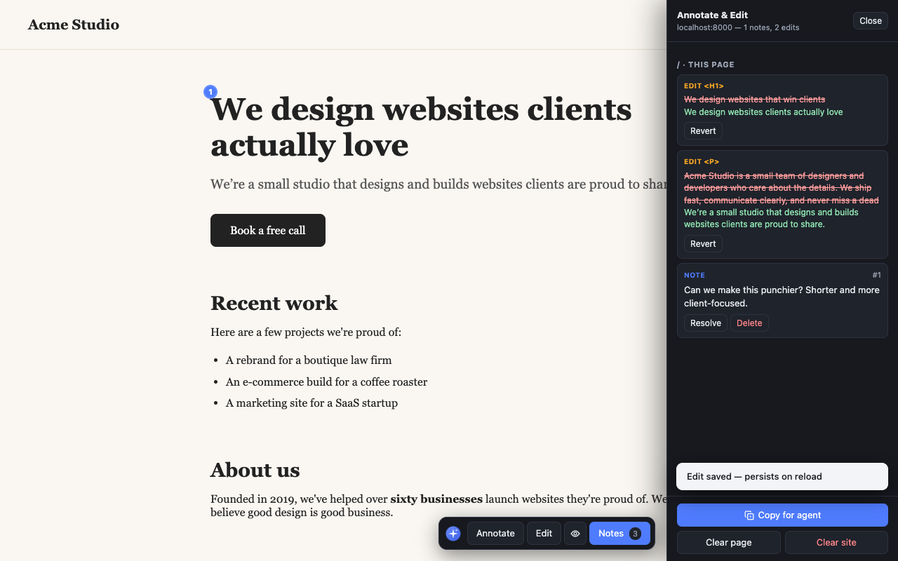

# Annotate & Edit

A free Chrome extension for reviewing websites: **annotate** any element and
**edit text live** on any page, then copy one structured prompt to paste into
an AI coding agent. No account, no backend, nothing leaves your browser.

## What it does

Built for the *client review* workflow:

1. A developer ships a staging link.
2. The client installs the extension — free, no account, no setup.
3. On the site they:
   - **Annotate** — click any element and pin a note ("remove this", "this
     heading should mention pricing").
   - **Edit** — click into headings, paragraphs, buttons and rewrite them in
     place; changes persist across reloads so they can keep refining.
4. They click **Copy for agent** and send the output back.
5. The developer pastes it into an AI coding agent, which applies every change
   for real — each item is anchored by a CSS selector and quoted text.

## Features

- **Annotate mode** — numbered pins with notes; captures selector, tag, text
  excerpt, neighbouring text, viewport width and timestamp. Click a pin to
  edit, resolve or delete.
- **Edit mode** — inline text editing on headings, paragraphs, links, buttons
  and more. Old → new text is recorded; Cancel restores the original.
- **Persistence** — everything stored in `chrome.storage.local`, survives
  reloads, navigation and restarts. Edits re-apply by selector + text match;
  stale ones are flagged, never applied blindly.
- **Review history** — numbered completed reviews, a running tally of applied
  changes, and per-review export/delete in the panel.
- **Agent-ready export** — one Markdown document with every note and edit,
  anchored so an agent can `grep` the codebase for each spot.
- **Works inside iframes** — preview wrappers that embed the app in a frame
  are fully supported (cross-origin, nested, `srcdoc`, dynamic).
- **Keyboard driven** — `a` annotate, `e` edit, `Esc` exits, `⌘⇧.` toggles the
  toolbar. Keystrokes typed into the extension never leak to page shortcuts.
- **Off by default** — no UI on any site until you toggle it on, per tab.

## Install

### From the Chrome Web Store

*Listing in progress — link coming once approved.*

### From source

1. `chrome://extensions` → enable **Developer mode** → **Load unpacked** →
   select `extension/`.
2. Click the extension icon (or `Cmd/Ctrl+Shift+.`) to toggle the toolbar on
   any page.

## Usage

- **Annotate** (`a`) — click an element, type a note, save.
- **Edit** (`e`) — click text, rewrite it, `⌘⏎` or Save to keep, `Esc`/Cancel
  to discard.
- **Notes** — opens the panel: everything on the site grouped by page, plus
  review history.
- **Copy for agent** — copies the full review as Markdown. A review can only
  be completed after copying, so work can't be lost unexported.
- **New review** — archives the current set as a numbered review and starts
  fresh; past reviews stay accessible under **History**.

## Privacy

No accounts, no telemetry, no network calls. All data lives in
`chrome.storage.local` on your device. Broad `http(s)` host access exists
because annotating arbitrary sites is the core function; `storage` persists
notes; `activeTab`/`scripting` recover the toolbar after an update.

## Prior art — why this exists

The **annotate → agent-prompt** space is crowded; the **live-edit → diff**
space has one close contender; **nothing free does both** in one extension
with a combined export.

| Tool | Annotate | Live text edit | Agent-ready export | Free / no account |
|---|---|---|---|---|
| [Agentation](https://www.agentation.com) (npm component; [unofficial ext forks](https://github.com/mwelche/agentation-extension)) | ✅ rich — selectors, React tree, MCP | ❌ (layout rearrange only) | ✅ markdown + MCP | ✅ OSS, but meant to be embedded in your own app |
| [Markagent](https://chromewebstore.google.com/detail/markagent-uiweb-feedback/hbmbjdgdofkpddalhjoapppnkoicpdjj) | ✅ + screenshots, journey recording | ❌ | ✅ tuned per agent | ✅ |
| [MarkUp](https://getmarkup.dev/docs) | ✅ drawing/callouts | ❌ | ✅ md + PNG | free in early access, no backend |
| [visual-annotator](https://github.com/wernerstrauch/visual-annotator), [annotator](https://github.com/AWhileLater/annotator), Element Select | ✅ | ❌ | ✅ | ✅ OSS |
| [Blip](https://chromewebstore.google.com/detail/blip/kngcenmicokfcpichmbonpmkdnigjjog) | ❌ | ✅ edit-in-place, autosaves, visual diffs | ✅ markdown diff | freemium (GitHub sync paid) |
| [ruttl](https://www.ruttl.com) | ✅ comments | ✅ text/image/CSS edits | ❌ SaaS dashboard | ❌ account required, paid tiers |
| Edit Anything / [goedit.me](https://goedit.me) / [web-edit](https://github.com/ryanlua/web-edit) | ❌ | ✅ | ❌ | ✅ |
| BugHerd, Marker.io, Usersnap, Pastel, Feedbucket, Simple Commenter, Leafy | ✅ | ❌ | partial (Leafy has agent export) | ❌ accounts, paid/freemium |

Blip is closest on the edit side and Agentation on the annotate side, but
neither does both, several require embedding a component in your own app, and
the SaaS feedback tools all want accounts and subscriptions.

## Development

Manifest V3, no build step. `content.js` is a self-contained script rendering
the whole UI inside a shadow root; `background.js` routes icon/shortcut and
cross-frame messages.

- `extension/` — the unpacked extension.
- `demo/` — standalone multi-page site for manual testing (serve it on
  :8000, and also :8001 to exercise cross-origin frames).
- `tools/smoke.mjs` — headless browser checks covering annotation, editing,
  persistence, shared iframe controls and export: `node tools/smoke.mjs`.
  For real-extension injection and messaging, run
  `AE_REAL_EXTENSION=1 AE_CHROME="/path/to/Chrome for Testing" node tools/smoke.mjs`.
- `tools/background.test.mjs` — `node --test` checks that frame messages can't
  escape their tab or spoof Chrome identities.
- `tools/startup-smoke.mjs` — toolbar recovery via real icon clicks in a
  disposable Chrome for Testing profile.
- `tools/gen_icons.py`, `tools/screenshots.mjs`, `tools/promo.mjs` — branding
  and store-asset generators.

## Contributing

PRs welcome. Please keep `node tools/smoke.mjs` green (and run
`node --test tools/background.test.mjs` when touching frame messaging).
Open an issue first for anything that changes permissions or the data model.

## License

MIT — see [LICENSE](LICENSE). Free for anyone to use.
